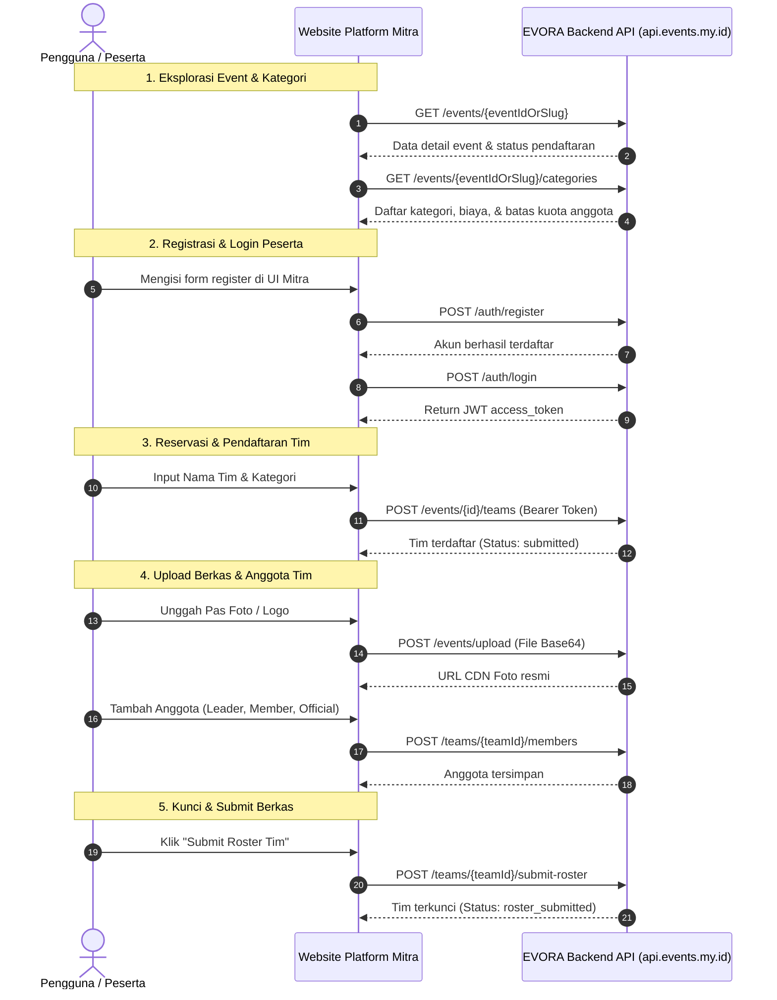

# Panduan Integrasi API EVORA untuk Platform Mitra Eksternal

Dokumentasi ini ditujukan bagi tim pengembang (*software engineers*) dari platform mitra yang ingin mengintegrasikan fitur perlombaan, pendaftaran tim, manajemen anggota (roster), dan modul e-voting dari EVORA ke dalam antarmuka (UI/UX) website atau aplikasi mereka sendiri (*Headless Architecture*).

---

## 1. Konsep & Arsitektur Integrasi

Dengan arsitektur **Headless API**:
* **Platform Mitra**: Mengontrol penuh tampilan desain, pengalaman pengguna (UI/UX), formulir pendaftaran, dan *branding* di website milik mitra.
* **EVORA Engine**: Bertindak sebagai *backend engine* yang mengelola validasi kuota tim secara atomik, penyimpanan berkas, verifikasi administrasi panitia, pencatatan suara, dan kalkulasi hasil.
* **Isolasi Data Event (Eksklusif)**: Event milik mitra dikonfigurasi sebagai `is_listed = false` di EVORA, sehingga **tidak akan pernah muncul** di katalog pencarian atau beranda publik `events.my.id`. Platform mitra cukup mengakses event menggunakan ID unik (`UUID`) atau `slug` resmi yang telah dialokasikan.



---

## 2. Standar Teknis & Konvensi

| Parameter | Keterangan |
| :--- | :--- |
| **Base URL Produksi** | `https://api.events.my.id` *(atau subdomain API resmi yang disepakati)* |
| **Format Request / Response** | `application/json` (Kecuali endpoint multipart bila ada) |
| **Header Autentikasi** | `Authorization: Bearer <access_token>` |
| **Format Waktu** | Standar ISO 8601 UTC (Contoh: `2026-10-27T10:00:00.000Z`) |
| **Format Pengidentifikasi** | UUID v4 (Contoh: `848bbdc0-3fa6-4076-9c4c-ff4e81dc0ec3`) |

---

## 3. Autentikasi & Akun Pengguna

Setiap aksi penulisan data tim dan anggota wajib mengatasnamakan pengguna yang terautentikasi melalui JSON Web Token (JWT).

### 3.1 Registrasi Pengguna Baru
Mendaftarkan akun baru bagi calon peserta lomba.

* **Method**: `POST`
* **Endpoint**: `/auth/register`
* **Autentikasi**: Tidak diperlukan (Publik)
* **Request Headers**:
  ```http
  Content-Type: application/json
  ```
* **Request Body**:
  ```json
  {
    "full_name": "Budi Santoso",
    "email": "budi.santoso@example.com",
    "password": "PasswordKuat123!"
  }
  ```
  > **Ketentuan Validasi Password**:
  > * Minimal 8 karakter, maksimal 128 karakter.
  > * Wajib mengandung minimal **1 huruf kecil**, **1 huruf besar**, dan **1 angka**.

* **Response Success (`201 Created`)**:
  ```json
  {
    "user_id": "9b1deb4d-3b7d-4bad-9bdd-2b0d7b3dcb6d",
    "email": "budi.santoso@example.com",
    "full_name": "Budi Santoso"
  }
  ```
* **Error Response**:
  * `409 Conflict`: Email sudah terdaftar sebelumnya.
  * `400 Bad Request`: Format email tidak valid atau kriteria password tidak terpenuhi.

---

### 3.2 Login Pengguna & Perolehan Token
Mendapatkan `access_token` JWT untuk digunakan pada seluruh endpoint transaksi tim.

* **Method**: `POST`
* **Endpoint**: `/auth/login`
* **Autentikasi**: Tidak diperlukan (Publik)
* **Request Body**:
  ```json
  {
    "email": "budi.santoso@example.com",
    "password": "PasswordKuat123!"
  }
  ```
* **Response Success (`200 OK`)**:
  ```json
  {
    "access_token": "eyJhbGciOiJSUzI1NiIsInR5cCI6IkpXVCJ9...",
    "user": {
      "id": "9b1deb4d-3b7d-4bad-9bdd-2b0d7b3dcb6d",
      "email": "budi.santoso@example.com",
      "full_name": "Budi Santoso",
      "avatar_url": null
    }
  }
  ```
  > **Saran Implementasi**: Simpan `access_token` di secure state / session storage platform Anda, dan sertakan sebagai header `Authorization: Bearer <access_token>` pada setiap pemanggilan API berikutnya.

---

### 3.3 Login & Registrasi Otomatis via Google (Google One Tap / Sign-In)
Memungkinkan pengguna masuk atau mendaftar otomatis dengan sekali klik menggunakan akun Google mereka tanpa perlu mengingat password.

* **Method**: `POST`
* **Endpoint**: `/auth/google`
* **Autentikasi**: Tidak diperlukan (Publik)
* **Request Body**:
  ```json
  {
    "credential": "eyJhbGciOiJSUzI1NiIsImtpZCI6IjFhMmIzY..."
  }
  ```
  > `credential` adalah Google ID Token (JWT) yang dihasilkan dari Google Identity Services SDK di sisi frontend platform mitra setelah pengguna memilih akun Google.

* **Alur Otomatis di Backend EVORA**:
  1. Jika email Google **belum pernah terdaftar**: EVORA otomatis membuat akun user baru (*Just-In-Time Provisioning*), inisialisasi dompet, dan mengikat kredensial Google.
  2. Jika email Google **sudah terdaftar** via email/password: EVORA otomatis menautkan kredensial Google ke akun tersebut.
  3. Mengembalikan `access_token` resmi EVORA.

* **Response Success (`200 OK`)**:
  ```json
  {
    "access_token": "eyJhbGciOiJSUzI1NiIsInR5cCI6IkpXVCJ9...",
    "user": {
      "id": "9b1deb4d-3b7d-4bad-9bdd-2b0d7b3dcb6d",
      "email": "budi.santoso@gmail.com",
      "full_name": "Budi Santoso",
      "avatar_url": "https://lh3.googleusercontent.com/a/ACg8oc..."
    }
  }
  ```
* **Error Response**:
  * `401 Unauthorized`: Token Google tidak valid atau sudah kadaluwarsa.
  * `400 Bad Request`: Email Google belum diverifikasi oleh Google.
  * `403 Forbidden`: Akun ditangguhkan.

---

## 4. Membaca Informasi Event & Kategori

### 4.1 Detail Event
Mengambil metadata event, jadwal pelaksanaan, status pendaftaran, dan spanduk (banner).

* **Method**: `GET`
* **Endpoint**: `/events/:idOrSlug`
* **Autentikasi**: Tidak diperlukan (Publik)
* **Parameter URL**:
  * `:idOrSlug` ➔ UUID event atau slug unik event mitra.
* **Response Success (`200 OK`)**:
  ```json
  {
    "id": "e30e137c-f12b-426c-94d7-402cf896c21e",
    "name": "Turnamen Futsal Mahasiswa Nasional 2026",
    "slug": "turnamen-futsal-2026",
    "description": "Kompetisi futsal tingkat perguruan tinggi se-Indonesia.",
    "banner_url": "https://ik.imagekit.io/evora/events/banner_futsal.jpg",
    "registration_status": "registration_open",
    "registration_start_date": "2026-10-01",
    "registration_end_date": "2026-11-15",
    "technical_meeting_date": "2026-11-20",
    "start_date": "2026-11-25",
    "end_date": "2026-11-30",
    "is_paid": true,
    "registration_fee": "250000.00",
    "payment_method": "payment_gateway",
    "is_listed": false
  }
  ```

---

### 4.2 Daftar Kategori Lomba & Batas Kuota Anggota
Digunakan untuk merender kartu kategori dan membaca aturan kuota masing-masing lomba.

* **Method**: `GET`
* **Endpoint**: `/events/:idOrSlug/categories`
* **Autentikasi**: Tidak diperlukan (Publik)
* **Response Success (`200 OK`)**:
  ```json
  [
    {
      "id": "c71a33df-b4a8-4b77-a8fe-b620021cfa5a",
      "event_id": "e30e137c-f12b-426c-94d7-402cf896c21e",
      "name": "Kategori Putra (U-21)",
      "min_team_members": 5,
      "max_team_members": 12,
      "slot_count": 32,
      "slot_taken": 14
    },
    {
      "id": "81f72a44-01ac-4648-910e-09a8eb1df205",
      "event_id": "e30e137c-f12b-426c-94d7-402cf896c21e",
      "name": "Kategori Putri (Umum)",
      "min_team_members": 5,
      "max_team_members": 12,
      "slot_count": 16,
      "slot_taken": 8
    }
  ]
  ```

---

## 5. Layanan Unggah Berkas & Pas Foto

Sebelum mengirimkan data anggota atau bukti bayar, berkas (gambar/foto) wajib diunggah terlebih dahulu untuk mendapatkan URL publik CDN resmi.

* **Method**: `POST`
* **Endpoint**: `/events/upload`
* **Autentikasi**: `Authorization: Bearer <access_token>`
* **Maksimum Ukuran Berkas**: 15 MB
* **Request Body**:
  ```json
  {
    "file": "data:image/jpeg;base64,/9j/4AAQSkZJRgABAQEASABIAAD...",
    "fileName": "pas_foto_peserta.jpg",
    "folder": "/evora/events/members"
  }
  ```
* **Response Success (`200 OK`)**:
  ```json
  {
    "url": "https://ik.imagekit.io/evora/events/members/pas_foto_peserta_xyz123.jpg",
    "fileId": "651a2bc0f12a3d0012e8ab9c"
  }
  ```

---

## 6. Pendaftaran & Manajemen Tim

### 6.1 Pendaftaran Awal Tim (Reservasi Slot Atomik)
Membuat tim baru dan mengamankan 1 kuota slot pada kategori lomba yang dipilih.

* **Method**: `POST`
* **Endpoint**: `/events/:idOrSlug/teams`
* **Autentikasi**: `Authorization: Bearer <access_token>`
* **Request Body**:
  ```json
  {
    "category_id": "c71a33df-b4a8-4b77-a8fe-b620021cfa5a",
    "team_name": "Garuda Juara FC",
    "logo_url": "https://ik.imagekit.io/.../logo_tim.png",
    "coach_name": "Indra Wijaya",
    "coach_phone": "081234567890",
    "payment_proof_url": "https://ik.imagekit.io/.../bukti_transfer.jpg"
  }
  ```
* **Response Success (`201 Created`)**:
  ```json
  {
    "ok": true,
    "team_id": "848bbdc0-3fa6-4076-9c4c-ff4e81dc0ec3",
    "status": "submitted"
  }
  ```
* **Error Response**:
  * `409 Conflict`: Kuota kategori telah penuh, atau user sudah memiliki tim terdaftar di kategori yang sama.
  * `400 Bad Request`: Format payload tidak valid.

---

### 6.2 Melihat Daftar Tim Milik Pengguna Saat Ini
Digunakan untuk menampilkan halaman **"Tim Saya"** atau dashboard partisipasi di platform mitra.

* **Method**: `GET`
* **Endpoint**: `/teams/me`
* **Autentikasi**: `Authorization: Bearer <access_token>`
* **Response Success (`200 OK`)**:
  ```json
  [
    {
      "id": "848bbdc0-3fa6-4076-9c4c-ff4e81dc0ec3",
      "team_name": "Garuda Juara FC",
      "status": "submitted",
      "logo_url": "https://ik.imagekit.io/.../logo_tim.png",
      "created_at": "2026-10-27T10:00:00.000Z",
      "category": {
        "id": "c71a33df-b4a8-4b77-a8fe-b620021cfa5a",
        "name": "Kategori Putra (U-21)",
        "min_team_members": 5,
        "max_team_members": 12
      },
      "event": {
        "id": "e30e137c-f12b-426c-94d7-402cf896c21e",
        "name": "Turnamen Futsal Mahasiswa Nasional 2026",
        "registration_status": "registration_open"
      }
    }
  ]
  ```

---

### 6.3 Melihat Rincian Lengkap Tim & Seluruh Anggota
* **Method**: `GET`
* **Endpoint**: `/teams/:id`
* **Autentikasi**: `Authorization: Bearer <access_token>`
* **Response Success (`200 OK`)**:
  ```json
  {
    "id": "848bbdc0-3fa6-4076-9c4c-ff4e81dc0ec3",
    "team_name": "Garuda Juara FC",
    "status": "submitted",
    "coach_name": "Indra Wijaya",
    "coach_phone": "081234567890",
    "members": [
      {
        "id": "a190b21c-4b72-4091-a20e-84b291dc0aa1",
        "team_id": "848bbdc0-3fa6-4076-9c4c-ff4e81dc0ec3",
        "full_name": "Budi Santoso",
        "role_in_team": "leader",
        "position_label": "Kapten / Flank",
        "nisn": "0051234567",
        "photo_url": "https://ik.imagekit.io/.../budi.jpg",
        "phone": "081234567890",
        "email": "budi@example.com"
      }
    ]
  }
  ```

---

### 6.4 Mengubah Nama Tim (Saat Tahap Revisi)
Hanya dapat dilakukan jika tim berstatus `registration_rejected`.

* **Method**: `PATCH`
* **Endpoint**: `/teams/:id`
* **Autentikasi**: `Authorization: Bearer <access_token>`
* **Request Body**:
  ```json
  {
    "team_name": "Garuda Juara Sejati FC"
  }
  ```

---

## 7. Manajemen Anggota Tim (Roster)

Hanya pemilik tim (`registered_by`) yang berhak memodifikasi anggota tim miliknya.

### 7.1 Menambahkan Anggota Tim
* **Method**: `POST`
* **Endpoint**: `/teams/:id/members`
* **Autentikasi**: `Authorization: Bearer <access_token>`
* **Request Body**:
  ```json
  {
    "full_name": "Rizky Ramadhan",
    "role_in_team": "member",
    "position_label": "Kiper / Penjaga Gawang",
    "nisn": "0059876543",
    "photo_url": "https://ik.imagekit.io/.../rizky.jpg",
    "phone": "081987654321",
    "email": "rizky@example.com"
  }
  ```
  > **Nilai Valid `role_in_team`**:
  > * `"leader"` ➔ Kapten / Ketua Tim
  > * `"member"` ➔ Anggota / Atlet
  > * `"official"` ➔ Manajer / Medis / Pelatih Pendamping

* **Response Success (`201 Created`)**:
  ```json
  {
    "id": "d7281bc0-1a22-4a0b-91bb-72d82910c229",
    "team_id": "848bbdc0-3fa6-4076-9c4c-ff4e81dc0ec3",
    "full_name": "Rizky Ramadhan",
    "role_in_team": "member",
    "position_label": "Kiper / Penjaga Gawang",
    "created_at": "2026-10-27T10:15:00.000Z"
  }
  ```

---

### 7.2 Memperbarui Data Anggota Tim
* **Method**: `PATCH`
* **Endpoint**: `/teams/:id/members/:memberId`
* **Autentikasi**: `Authorization: Bearer <access_token>`
* **Request Body** *(hanya kirim field yang ingin diubah)*:
  ```json
  {
    "full_name": "Rizky Ramadhan Putra",
    "position_label": "Anchor"
  }
  ```
* **Response Success (`200 OK`)**: Mengembalikan objek anggota yang telah diperbarui.

---

### 7.3 Menghapus Anggota Tim
* **Method**: `DELETE`
* **Endpoint**: `/teams/:id/members/:memberId`
* **Autentikasi**: `Authorization: Bearer <access_token>`
* **Response Success (`200 OK`)**:
  ```json
  {
    "ok": true
  }
  ```

---

### 7.4 Mengunci & Mengirimkan Pengajuan Roster (Submit Roster)
Dipanggil saat seluruh kuota minimum anggota telah terpenuhi (`members.length >= min_team_members`). Status tim akan beralih ke `roster_submitted` dan form terkunci untuk menunggu verifikasi panitia.

* **Method**: `POST`
* **Endpoint**: `/teams/:id/submit-roster`
* **Autentikasi**: `Authorization: Bearer <access_token>`
* **Request Body**: `{}` (Kosong)
* **Response Success (`200 OK`)**:
  ```json
  {
    "ok": true,
    "status": "roster_submitted"
  }
  ```
* **Error Response (`400 Bad Request`)**:
  ```json
  {
    "error": "Jumlah anggota tim belum memenuhi batas minimum (minimal 5 orang)"
  }
  ```

---

### 7.5 Membatalkan Pengiriman Roster (Unsubmit)
Dapat dipanggil apabila peserta ingin mengedit kembali berkas anggota **selama panitia belum memulai verifikasi final**.

* **Method**: `POST`
* **Endpoint**: `/teams/:id/unsubmit-roster`
* **Autentikasi**: `Authorization: Bearer <access_token>`
* **Request Body**: `{}` (Kosong)
* **Response Success (`200 OK`)**:
  ```json
  {
    "ok": true,
    "status": "submitted"
  }
  ```

---

## 8. Siklus Hidup & Status Tim (Team Status Lifecycle)

Gunakan status di bawah ini untuk menampilkan indikator visual (*badge*) pada UI platform mitra:

| Status Tim | Arti Status | Aksi yang Diizinkan di UI Mitra |
| :--- | :--- | :--- |
| `submitted` | Tim berhasil didaftarkan, slot aman. | Tambah, ubah, dan hapus anggota tim. Tombol "Submit Roster" aktif jika kuota min terpenuhi. |
| `registration_rejected` | Pendaftaran tim ditolak oleh panitia (misal: nama tim melanggar aturan). | User dapat merevisi nama tim via `PATCH /teams/:id`. |
| `registration_verified` | Pendaftaran awal diverifikasi. | Lanjutkan melengkapi berkas anggota tim. |
| `roster_submitted` | Berkas anggota telah dikirim lengkap ke panitia. | Form anggota dinonaktifkan (*read-only*). User dapat melakukan *unsubmit* jika perlu revisi sebelum diverifikasi. |
| `roster_rejected` | Berkas ada yang tidak lengkap / ditolak juri verifikator. | Form anggota aktif kembali untuk diperbaiki dan di-submit ulang. |
| `verified` | **Sah / Lolos Verifikasi**. | Tim resmi terdaftar untuk bertanding. Data terkunci permanen. |

---

## 9. Modul E-Voting & Perolehan Suara (Opsional)

Jika platform mitra juga menyelenggarakan sesi voting online (misal: *Juara Favorit*, *Best Supporter*):

### 9.1 Detail Voting & Daftar Kandidat
* **Method**: `GET`
* **Endpoint**: `/votings/:id`
* **Autentikasi**: Tidak diperlukan (Publik)
* **Response Success (`200 OK`)**:
  ```json
  {
    "id": "f0ee336e-9d1b-4b61-90df-1a42c7b5941f",
    "title": "Pemilihan Tim Terfavorit 2026",
    "status": "open",
    "banner_url": "https://ik.imagekit.io/.../voting_banner.jpg",
    "candidates": [
      {
        "id": "c1a2b3c4-...",
        "name": "Garuda Juara FC",
        "description": "Perwakilan Kampus A",
        "image_url": "https://ik.imagekit.io/.../foto.jpg",
        "public_token": "cand_91abc..."
      }
    ]
  }
  ```

---

### 9.2 Leaderboard / Perolehan Suara Realtime
* **Method**: `GET`
* **Endpoint**: `/votings/:id/leaderboard`
* **Autentikasi**: Tidak diperlukan (Publik)
* **Response Success (`200 OK`)**:
  ```json
  {
    "voting_id": "f0ee336e-9d1b-4b61-90df-1a42c7b5941f",
    "entries": [
      {
        "rank": 1,
        "candidate_id": "c1a2b3c4-...",
        "candidate_name": "Garuda Juara FC",
        "total_points": 1450
      }
    ]
  }
  ```

---

### 9.3 Voting Langsung via Payment Gateway (Direct Vote)
Memungkinkan pengunjung di website mitra langsung memberikan suara berbayar tanpa harus membuat akun login di EVORA.

* **Method**: `POST`
* **Endpoint**: `/votings/:voting_id/direct-vote`
* **Autentikasi**: Tidak diperlukan (Publik)
* **Request Body**:
  ```json
  {
    "candidate_token": "cand_91abc...",
    "custom_points": 10,
    "voter_name": "Dedi Kurniawan",
    "voter_email": "dedi@gmail.com"
  }
  ```
* **Response Success (`200 OK`)**: Mengembalikan instruksi pembayaran Midtrans / Duitku (URL QRIS / Virtual Account) untuk diselesaikan oleh pemilih.

---

## 10. Referensi Kode Integrasi (TypeScript / Axios)

Berikut contoh fungsi pembungkus (*client wrapper*) yang dapat disalin ke dalam *codebase* platform mitra:

```typescript
import axios from 'axios';

const evoraApi = axios.create({
  baseURL: 'https://api.events.my.id',
  headers: {
    'Content-Type': 'application/json',
  },
});

// Interceptor untuk menyertakan token otomatis jika user sudah login
export function setAuthToken(token: string | null) {
  if (token) {
    evoraApi.defaults.headers.common['Authorization'] = `Bearer ${token}`;
  } else {
    delete evoraApi.defaults.headers.common['Authorization'];
  }
}

// 1. Ambil detail event mitra
export async function getEventDetail(eventIdOrSlug: string) {
  const response = await evoraApi.get(`/events/${eventIdOrSlug}`);
  return response.data;
}

// 2. Registrasi akun peserta baru
export async function registerParticipant(fullName: string, email: string, password: string) {
  const response = await evoraApi.post('/auth/register', {
    full_name: fullName,
    email,
    password,
  });
  return response.data;
}

// 3. Login peserta dan set token
export async function loginParticipant(email: string, password: string) {
  const response = await evoraApi.post('/auth/login', { email, password });
  const { access_token, user } = response.data;
  setAuthToken(access_token);
  return { access_token, user };
}

// 3b. Login / Register otomatis via Google ID Token
export async function loginWithGoogle(googleIdToken: string) {
  const response = await evoraApi.post('/auth/google', { credential: googleIdToken });
  const { access_token, user } = response.data;
  setAuthToken(access_token);
  return { access_token, user };
}

// 4. Daftarkan tim baru
export async function registerTeam(eventSlug: string, categoryId: string, teamName: string, extra?: {
  logoUrl?: string;
  coachName?: string;
  coachPhone?: string;
}) {
  const response = await evoraApi.post(`/events/${eventSlug}/teams`, {
    category_id: categoryId,
    team_name: teamName,
    logo_url: extra?.logoUrl,
    coach_name: extra?.coachName,
    coach_phone: extra?.coachPhone,
  });
  return response.data;
}

// 5. Tambah anggota tim
export async function addTeamMember(teamId: string, memberData: {
  fullName: string;
  roleInTeam: 'leader' | 'member' | 'official';
  positionLabel?: string;
  nisn?: string;
  photoUrl?: string;
  phone?: string;
  email?: string;
}) {
  const response = await evoraApi.post(`/teams/${teamId}/members`, {
    full_name: memberData.fullName,
    role_in_team: memberData.roleInTeam,
    position_label: memberData.positionLabel,
    nisn: memberData.nisn,
    photo_url: memberData.photoUrl,
    phone: memberData.phone,
    email: memberData.email,
  });
  return response.data;
}

// 6. Submit roster tim untuk verifikasi
export async function submitTeamRoster(teamId: string) {
  const response = await evoraApi.post(`/teams/${teamId}/submit-roster`, {});
  return response.data;
}
```

