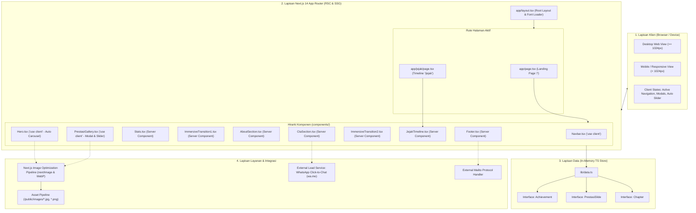
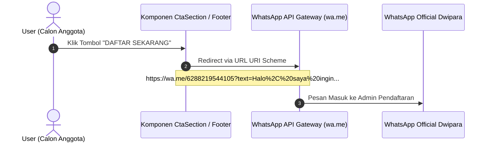
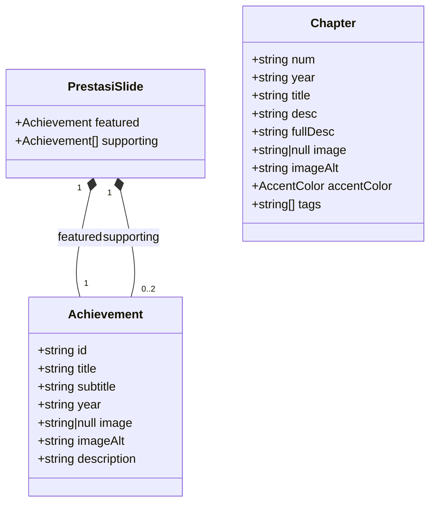
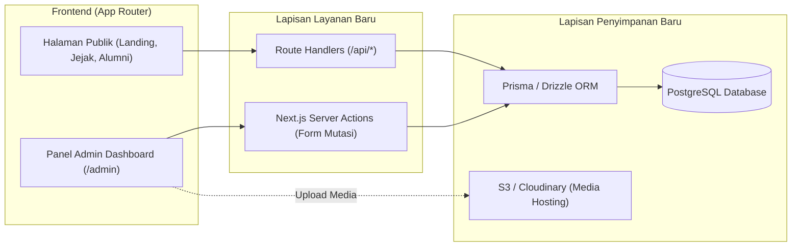

# Laporan Arsitektur Sistem — Dwipara Landing Page
**Project**: Pasukan Bendera SMAN 2 Mengwi (Dwipara Dwisma)  
**Dokumentasi Teknis & Status Implementasi Arsitektur Aktual**  
**Tanggal**: 22 Oktober 2026  
**Status Audit**: Berdasarkan Kode Sumber Terimplementasi (*Source-Truth Verification*)

---

## Daftar Isi
1. [Ringkasan Eksekutif & Pola Arsitektur](#1-ringkasan-eksekutif--pola-arsitektur)
2. [Diagram Arsitektur Sistem Aktual](#2-diagram-arsitektur-sistem-aktual)
3. [Struktur Direktori & Pemisahan Tanggung Jawab](#3-struktur-direktori--pemisahan-tanggung-jawab)
4. [Lapisan Presentasi & Frontend (UI/UX)](#4-lapisan-presentasi--frontend-uiux)
   - [React Server Components (RSC) vs Client Components](#41-react-server-components-rsc-vs-client-components)
   - [Peta Rute & Hirarki Komponen](#42-peta-rute--hirarki-komponen)
   - [Manajemen State & Interaktivitas Klien](#43-manajemen-state--interaktivitas-klien)
   - [Sistem Desain & Token Visual](#44-sistem-desain--token-visual)
5. [Lapisan Layanan (Service Layer Architecture)](#5-lapisan-layanan-service-layer-architecture)
   - [Audit Layanan Backend & Microservices](#51-audit-layanan-backend--microservices)
   - [Layanan Internal Next.js](#52-layanan-internal-nextjs)
   - [Integrasi Layanan Eksternal & Handler Protokol](#53-integrasi-layanan-eksternal--handler-protokol)
6. [Lapisan Data & Penyimpanan (Database Architecture)](#6-lapisan-data--penyimpanan-database-architecture)
   - [Audit Database & ORM](#61-audit-database--orm)
   - [In-Memory Static TypeScript Data Store](#62-in-memory-static-typescript-data-store)
   - [Model & Skema Data](#63-model--skema-data)
7. [Infrastruktur, Runtime, & Build Pipeline](#7-infrastruktur-runtime--build-pipeline)
8. [Analisis Kesenjangan (Gap Analysis) & Roadmap Skalabilitas](#8-analisis-kesenjangan-gap-analysis--roadmap-skalabilitas)

---

## 1. Ringkasan Eksekutif & Pola Arsitektur

Project **Dwipara Landing Page** dirancang sebagai portal web profil organisasi dan landing page interaktif untuk unit kegiatan Paskibraka SMAN 2 Mengwi (*Dwipara Dwisma*).

Berdasarkan audit menyeluruh terhadap kode sumber yang terpasang dan berjalan, arsitektur sistem yang **benar-benar terimplementasi saat ini** adalah:

> **Arsitektur Jamstack Modern berbasis Next.js 14 (App Router) dengan Hybrid Rendering (RSC + Client Interactive Islands) dan In-Memory TypeScript Data Store.**

### Karakteristik Kunci:
1. **Zero Database Engine Overhead**: Tidak ada DBMS relasional (PostgreSQL, MySQL, SQLite) maupun NoSQL (MongoDB, Firebase) yang berjalan. Seluruh data organisasi bersifat terstruktur dan didefinisikan secara statis di dalam modul TypeScript (*Code-as-Data*).
2. **Server-Side Optimization & Client Islands**: Menggunakan Next.js 14 App Router. Komponen statis dirender di server sebagai Server Components, sedangkan komponen interaktif (carousel, modal detail, drawer navigasi, scroll-spy) diisolasi sebagai Client Components (`"use client"`).
3. **Client-Side Outbound Service Routing**: Tidak terdapat lapisan middleware backend atau API routes internal (`app/api/*`). Transaksi konversi pengguna (pendaftaran anggota baru) dialihkan langsung ke layanan WhatsApp Business melalui protokol URI handler (*Deep Linking*).

---

## 2. Diagram Arsitektur Sistem Aktual

Berikut adalah diagram alur dan arsitektur komponen yang aktif berjalan di dalam aplikasi:



---

## 3. Struktur Direktori & Pemisahan Tanggung Jawab

Arsitektur direktori mengikuti pola modularitas berbasis fitur (*feature-and-section based separation*):

```
DwiparaLandingPage/
├── app/                              # Next.js 14 App Router Layer
│   ├── globals.css                   # Global styles & CSS variable design tokens
│   ├── layout.tsx                    # Root Layout, HTML Lang, Metadata, Font Injector
│   ├── page.tsx                      # Beranda (Halaman Utama Landing Page)
│   └── jejak/
│       └── page.tsx                  # Dedicated Page: Arsip Linimasa Kegiatan
├── components/                       # Modul Presentasi Reusable
│   ├── layout/                       # Komponen Shell Layout Global
│   │   ├── Navbar.tsx                # Sticky Navigation, Scroll-Spy, Mobile Menu
│   │   └── Footer.tsx                # Footer Branding, Navigation, Social Links
│   └── sections/                     # Section Komponen Khusus Landing Page
│       ├── AboutSection.tsx          # Profil, Visi, Kolase Foto, Nilai Organisasi
│       ├── CtaSection.tsx            # Call to Action Pendaftaran & Link WhatsApp
│       ├── Hero.tsx                  # Hero Section & Portrait Auto-Slide Show
│       ├── ImmersiveTransition1.tsx  # Banner Transisi 1 (Full-Bleed + Quote)
│       ├── ImmersiveTransition2.tsx  # Banner Transisi 2 (Bauhaus Shapes + Headline)
│       ├── JejakTimeline.tsx         # Preview Linimasa Kegiatan (Chapter 1–3)
│       ├── PrestasiGallery.tsx       # Galeri Prestasi Interaktif & Detail Modal
│       └── Stats.tsx                 # Grid Metrik Statistik Kunci
├── lib/                              # Data & Utility Layer
│   └── data.ts                       # Typed In-Memory Data Store (Prestasi & Chapters)
├── pages/                            # Legacy Next.js Pages Router (Transitional)
│   └── _document.tsx                 # Custom Document fallback
├── public/                           # Static Asset Engine
│   └── images/                       # File Gambar Resolusi Tinggi (JPG/PNG)
├── next.config.mjs                   # Konfigurasi Runtime Next.js & Webpack
├── tailwind.config.ts                # Konfigurasi Token Warna & Spacing
├── tsconfig.json                     # Konfigurasi Compiler TypeScript
└── package.json                      # Dependency Manifest
```

---

## 4. Lapisan Presentasi & Frontend (UI/UX)

### 4.1 React Server Components (RSC) vs Client Components

Aplikasi menerapkan pola arsitektur **Islands Architecture** di mana sebagian besar komponen dirender secara statis di sisi server untuk efisiensi transfer JavaScript ke browser:

| Komponen | Tipe | Direktif | Alasan & Tanggung Jawab |
|---|---|---|---|
| [`app/layout.tsx`](file:///c:/Users/Yosua%20Triantara/Documents/Project/DwiparaLandingPage/app/layout.tsx) | Server | Default | Load font Google `Plus_Jakarta_Sans`, inject metadata SEO, HTML boilerplate. |
| [`app/page.tsx`](file:///c:/Users/Yosua%20Triantara/Documents/Project/DwiparaLandingPage/app/page.tsx) | Server | Default | Komposisi vertikal seluruh section beranda dengan spacing konsisten. |
| [`app/jejak/page.tsx`](file:///c:/Users/Yosua%20Triantara/Documents/Project/DwiparaLandingPage/app/jejak/page.tsx) | Server | Default | Rendering arsip kegiatan lengkap dengan metadata dinamis. |
| [`components/layout/Navbar.tsx`](file:///c:/Users/Yosua%20Triantara/Documents/Project/DwiparaLandingPage/components/layout/Navbar.tsx) | **Client** | `"use client"` | Deteksi event `window.scroll`, auto-highlight active menu link, toggle mobile menu. |
| [`components/sections/Hero.tsx`](file:///c:/Users/Yosua%20Triantara/Documents/Project/DwiparaLandingPage/components/sections/Hero.tsx) | **Client** | `"use client"` | Timer auto-advance interval (`3000ms`), state transisi index foto portrait hero. |
| [`components/sections/PrestasiGallery.tsx`](file:///c:/Users/Yosua%20Triantara/Documents/Project/DwiparaLandingPage/components/sections/PrestasiGallery.tsx) | **Client** | `"use client"` | Navigasi slider slide prestasi, filter kategori, kontrol modal pop-up detail prestasi. |
| Komponen Section Lainnya (`Stats`, `AboutSection`, `CtaSection`, dll) | Server | Default | Static rendering tanpa bundle JS klien berlebih. |

### 4.2 Peta Rute & Hirarki Komponen

Aplikasi mengimplementasikan 2 rute navigasi publik:
1. **`/` (Root Route)**:
   - File: [`app/page.tsx`](file:///c:/Users/Yosua%20Triantara/Documents/Project/DwiparaLandingPage/app/page.tsx)
   - Memuat: `Navbar` → `Hero` → `Stats` → `ImmersiveTransition1` → `AboutSection` → `PrestasiGallery` → `ImmersiveTransition2` → `JejakTimeline` → `CtaSection` → `Footer`.
2. **`/jejak` (Dedicated Archive Route)**:
   - File: [`app/jejak/page.tsx`](file:///c:/Users/Yosua%20Triantara/Documents/Project/DwiparaLandingPage/app/jejak/page.tsx)
   - Menampilkan daftar lengkap linimasa kegiatan Paskibraka dalam tata letak zigzag bergantian (*alternating cards*) dengan sistem tag warna khusus.

> **Catatan Arsitektural mengenai `pages/_document.tsx`**:  
> Terdapat file [`pages/_document.tsx`](file:///c:/Users/Yosua%20Triantara/Documents/Project/DwiparaLandingPage/pages/_document.tsx) yang merupakan artefak dari Next.js Pages Router. Karena aplikasi sudah sepenuhnya menggunakan Next.js App Router (`app/layout.tsx`), file ini berstatus *redundant/legacy artifact* dan tidak mempengaruhi runtime App Router.

### 4.3 Manajemen State & Interaktivitas Klien

Aplikasi tidak menggunakan global state library eksternal (seperti Redux, Zustand, atau React Context) karena kebutuhan state masih bersifat lokal (*localized component state*):
- **Navbar Scroll-Spy**: Menghitung `window.scrollY` terhadap `offsetTop` elemen target (`#hero`, `#tentang`, `#prestasi`, `#jejak`, `#alumni`) dengan event listener pasif untuk efisiensi 60 FPS.
- **Hero Slider**: Menggunakan kombinasi `useState(0)` dan `useEffect` dengan interval timer 3 detik (`AUTO_MS = 3000`).
- **Prestasi Gallery Modal**: Memiliki state `selectedAchievement` yang merender portal modal dan mengunci interaksi latar belakang saat modal aktif.

### 4.4 Sistem Desain & Token Visual

Sistem styling dibangun dengan arsitektur utility-first menggunakan Tailwind CSS yang diperluas dengan token khusus yang mencerminkan filosofi visual *Bauhaus / Architectural Editorial*:

| Token Tailwind | Nilai Hex | Peruntukan Arsitektural |
|---|---|---|
| `primary` | `#1F5B45` | Forest Green: Warna identitas utama, tombol primer, heading, border |
| `primary-dark` | `#005500` | Deep Green: Nuansa latar kontras dan bayangan |
| `accent-red` | `#550000` | Rust/Maroon: Aksen garis pembatas, dot indikator, sorotan teks |
| `accent-orange` | `#FFAA00` | Amber/Gold: Ornamen geometris, highlight sekunder, lencana penghargaan |
| `ink` | `#121C2A` | Deep Charcoal: Warna teks dasar dengan kontras tinggi |

---

## 5. Lapisan Layanan (Service Layer Architecture)

### 5.1 Audit Layanan Backend & Microservices

Berdasarkan pemeriksaan menyeluruh:
- ❌ **Tidak ada internal REST atau GraphQL API** (`/app/api/...` atau `/pages/api/...`).
- ❌ **Tidak ada Next.js Server Actions** (`"use server"`).
- ❌ **Tidak ada Microservice backend independen** (Node/Express, NestJS, Go, Python, dll).

### 5.2 Layanan Internal Next.js

Layanan internal yang aktif adalah bawaan dari Next.js runtime:
1. **Image Optimization Service (`next/image`)**:
   - Memproses kompresi gambar on-the-fly menjadi format modern `image/webp`.
   - Mengatur lazy-loading otomatis, layout sizing responsif, serta proteksi *Cumulative Layout Shift (CLS)*.
2. **Static Asset Pipeline**:
   - Direktori [`public/images/`](file:///c:/Users/Yosua%20Triantara/Documents/Project/DwiparaLandingPage/public/images/) bertindak sebagai static storage untuk melayani aset media publik secara langsung.

### 5.3 Integrasi Layanan Eksternal & Handler Protokol

Untuk kebutuhan interaksi dan operasional organisasi, aplikasi menghubungkan klien langsung ke platform pihak ketiga:



1. **Lead Conversion / Recruitment Service**:
   - Diimplementasikan di [`components/sections/CtaSection.tsx`](file:///c:/Users/Yosua%20Triantara/Documents/Project/DwiparaLandingPage/components/sections/CtaSection.tsx#L78).
   - Menggunakan format tautan WhatsApp Click-to-Chat:  
     `https://wa.me/6288219544105?text=Halo%2C%20saya%20ingin%20mendaftar%20sebagai%20anggota%20Dwipara%20Dwisma.`
   - Menghilangkan kebutuhan backend pendaftaran dan database pendaftar di fase peluncuran awal.
2. **Direct Inquiry Service**:
   - Diimplementasikan di [`components/layout/Footer.tsx`](file:///c:/Users/Yosua%20Triantara/Documents/Project/DwiparaLandingPage/components/layout/Footer.tsx#L13).
   - Menggunakan protokol `mailto:dwipara@sman2mengwi.sch.id`.

---

## 6. Lapisan Data & Penyimpanan (Database Architecture)

### 6.1 Audit Database & ORM

Berdasarkan audit dependensi [`package.json`](file:///c:/Users/Yosua%20Triantara/Documents/Project/DwiparaLandingPage/package.json) dan direktori proyek:
- ❌ **Tidak ada sistem Database Management System (DBMS)** fisik terpasang (MySQL, PostgreSQL, MongoDB, MariaDB, SQLite).
- ❌ **Tidak ada Object-Relational Mapping (ORM) / Query Builder** terpasang (Prisma, Drizzle, TypeORM, Mongoose).
- ❌ **Tidak ada Cloud BaaS Client SDK** (Supabase, Firebase, Appwrite).

### 6.2 In-Memory Static TypeScript Data Store

Sebagai pengganti database eksternal, seluruh data domain dikelola melalui modul **In-Memory Type-Safe Static Data Store** pada file [`lib/data.ts`](file:///c:/Users/Yosua%20Triantara/Documents/Project/DwiparaLandingPage/lib/data.ts).

Pola ini memberikan sejumlah keunggulan pada skala landing page:
- **Zero Query Latency**: Data diimpor secara langsung saat build/compile time.
- **Strict Type Safety**: Struktur data divalidasi langsung oleh compiler TypeScript sebelum runtime.
- **Git-driven Content Management**: Riwayat perubahan data terdokumentasi rapi di dalam Git commit history.

### 6.3 Model & Skema Data

Struktur entitas yang didefinisikan dalam kode sumber adalah sebagai berikut:



#### Spesifikasi Entitas:
1. **Achievement (`Achievement`)**:
   - `id`: Identitas unik data (mis. `"p1"`, `"p2"`).
   - `title`: Judul penghargaan / piala.
   - `subtitle`: Nama ajang kompetisi.
   - `year`: Tahun perolehan prestasi.
   - `image`: Jalur file aset visual (`/images/...`) atau `null` jika tanpa gambar.
   - `imageAlt`: Teks aksesibilitas gambar.
   - `description`: Deskripsi detail riwayat kompetisi untuk kebutuhan modal dialog.
2. **PrestasiSlide (`PrestasiSlide`)**:
   - Model representasi tata letak slider bento-grid, terdiri dari 1 kartu utama (`featured`) dan hingga 2 kartu pendukung (`supporting`).
3. **Chapter (`Chapter`)**:
   - `num`: Penomoran chapter format 2 digit (`"01"`, `"02"`, `"03"`).
   - `year`: Tahun kegiatan.
   - `title`: Nama agenda/kegiatan.
   - `desc`: Ringkasan pendek untuk preview di beranda (`JejakTimeline.tsx`).
   - `fullDesc`: Deskripsi mendalam untuk halaman detail arsip (`app/jejak/page.tsx`).
   - `accentColor`: Enum tipe warna aksen (`"orange"` | `"red"` | `"green"`).
   - `tags`: Label klasifikasi kegiatan (mis. `["REKRUTMEN", "TAHUNAN"]`).

---

## 7. Infrastruktur, Runtime, & Build Pipeline

### 7.1 Runtime & Dependencies
- **Node.js Environment**: Kompatibel dengan Node.js 18+ hingga Node.js 22.
- **Next.js Engine**: Versi `^14.2.0` (App Router Core).
- **React Framework**: Versi `^18.3.0`.
- **CSS Preprocessor**: Tailwind CSS `^3.4.1` diproses melalui PostCSS `^8.4.40` dan Autoprefixer `^10.4.20`.

### 7.2 Konfigurasi Khusus Build (`next.config.mjs`)
Pada file [`next.config.mjs`](file:///c:/Users/Yosua%20Triantara/Documents/Project/DwiparaLandingPage/next.config.mjs), terdapat optimasi khusus untuk mencegah kegagalan Webpack threading pada lingkungan Windows dan Node 22:
```javascript
/** @type {import('next').NextConfig} */
const nextConfig = {
  images: {
    formats: ["image/webp"],
  },
  experimental: {
    // Membantu resolusi webpack chunk pada Node 22 + Windows OS
    workerThreads: false,
    cpus: 1,
  },
};

export default nextConfig;
```

---

## 8. Analisis Kesenjangan (Gap Analysis) & Roadmap Skalabilitas

Apabila project Dwipara Landing Page akan dikembangkan menjadi platform web organisasi skala penuh (*Full-Stack Enterprise / Organization Portal*), berikut adalah perbandingan antara kondisi aktual saat ini dan arsitektur target masa depan:

| Aspek | Kondisi Terimplementasi Saat Ini | Rekomendasi Target Skalabilitas |
|---|---|---|
| **Penyimpanan Data** | File statis `lib/data.ts` | Database Relasional (PostgreSQL / SQLite via Prisma atau Drizzle ORM) atau Headless CMS (Sanity / Strapi) |
| **Pendaftaran Anggota** | Tautan eksternal WhatsApp Web/App | Form Pendaftaran Online + Server Action + Validasi Zod + Database Storage |
| **Otentikasi & Admin** | Tidak ada panel admin (update via code) | Dashboard Admin berbasis NextAuth.js / Supabase Auth untuk input prestasi & artikel |
| **API & Layanan** | Client-direct redirect | Next.js Route Handlers (`app/api/alumni`, `app/api/prestasi`) dengan caching tag |
| **Manajemen Media** | Direktori lokal `public/images/` | Cloud Object Storage (Cloudinary / AWS S3 / Supabase Storage) |

### Blueprint Arsitektur Target (Next Evolution Phase)



---

## 9. Kesimpulan Audit

Arsitektur yang saat ini terimplementasi di dalam repository **Dwipara Landing Page** adalah arsitektur **Frontend-Driven Jamstack** yang ramping, cepat, dan terfokus pada performa tampilan. Ketiadaan backend dan database eksternal merupakan pendekatan yang tepat untuk fase landing page profil organisasi saat ini, karena meminimalkan biaya server, menghilangkan vektor celah keamanan database, dan memaksimalkan kecepatan muat halaman (*load time*). 

Struktur kode yang modular dan *type-safe* memastikan bahwa ketika project siap berevolusi ke arsitektur full-stack, transisi dapat dilakukan secara bertahap tanpa perlu merombak ulang komponen UI yang sudah dibangun.

---
*Laporan ini dihasilkan dari analisis statis menyeluruh terhadap seluruh modul, komponen, konfigurasi, dan dependensi proyek.*

